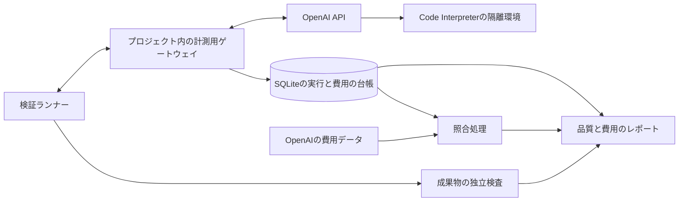

# LLM検証のゲートウェイと費用計測

更新日: 2026-10-12

位置付け: [直接編集の検証計画](../plans/llm-file-editing-evaluation.md)を実行するための設計。ローカルのゲートウェイ・費用台帳・合成ケース・静的評価器を実装済み。初回の有料実験は共通予算$10内で完了し、47応答の推計費用は$2.924513275。使用量・成果物・後片付けを記録した。実測と未照合事項は[検証結果](../reports/llm-file-editing-poc-2026-10-12.md)を参照する。操作は[検証用README](../../experiments/llm-export/README.md)を参照する。

## 採用する構成案

このプロジェクトに計測用の小さなゲートウェイを置き、すべての実験用OpenAI呼び出しを通す。ゲートウェイがAPIキー、使用量の記録、料金計算、予算制御を担当する。検証ランナーはケースの実行と採点を担当し、Excelを編集する実行環境にはAPIキーや費用台帳を渡さない。

初回は `experiments/llm-export` 内のNode/TypeScriptによるローカルプロセスとSQLiteで実装する。HTTPの入口はループバックだけに公開し、実行用トークンで認証する。既存のHono/Cloudflare Workersアプリへ組み込むのは、検証で必要な動作が固まった後とする。生成コードやLibreOfficeはゲートウェイ内で実行しない。

Files・Containers・成果物取得・削除も同じクライアント経由で記録する。料金が発生する操作だけでなく、どの実行のファイルとコンテナかを追えるようにする。任意のURLを転送できる汎用プロキシにはせず、使用するOpenAIの操作とモデルを限定する。

## 何を費用として報告するか

| 区分                   | 根拠                                      | レポート上の扱い                                            |
| ---------------------- | ----------------------------------------- | ----------------------------------------------------------- |
| 使用量                 | 各API応答のusage                          | APIが返した計測値。欠落は不明として残す                     |
| 使用量から計算した費用 | usageと実行日の料金表                     | ケース・試行・モデル別の推計額                              |
| OpenAI側の計上額       | Costs APIまたはダッシュボードの費用データ | ホスト型ツールを含む実験専用Projectの期間集計として照合する |
| OpenAI以外の費用       | 外部の変換環境、ゲートウェイ、ログ保存等  | OpenAI計上額に含まれないものだけを別計上する                |

ゲートウェイだけでは実際の請求額を確定できない。APIのusageからの積み上げとOpenAI側の計上額を両方残し、差分と未照合分を明示する。最終請求書の税・クレジット等を含む支払額が必要な場合は、API利用料とは別欄で扱う。

Code Interpreterのコンテナ費用はOpenAI利用料の内訳とする。提供元集計に含まれるコンテナ費用を「その他」として再加算しない。総額はOpenAI利用料と外部費用の重複しない項目から計算し、推計総額と照合済み総額を別々に表示する。

OpenAI Costs APIは日単位の集計で、Project・課金項目・APIキー等で絞り込み・集計できる。実験の任意の `run_id` ごとの確定請求を返すAPIではない。取得には管理用の権限が必要なため、通常のモデル実行キーだけで取得できると仮定しない。[OpenAI Costs API](https://developers.openai.com/api/reference/resources/admin/subresources/organization/subresources/usage/methods/costs)

初回は専用のOpenAI Projectと、そのProjectの実験専用APIキーを推奨する。他の処理を同じProjectで実行しなければ、同一UTC期間の台帳と提供元集計を比較しやすい。管理キーは照合用の別プロセスだけで使う。管理権限がなければ、ダッシュボードから得た費用データを取り込み、照合できるまで「請求未照合」とする。

## 記録単位と最小の台帳

同じケースの再実行、同じ試行中のモデルとの複数往復、通信の再送を区別する。

| 記録           | 主な項目                                                                                        |
| -------------- | ----------------------------------------------------------------------------------------------- |
| 実験           | `experiment_id`、ケース集合・方式・予算、料金表の版、開始・終了日時                             |
| 試行           | `run_id`、ケース・モデル・プロンプト・入力の版、反復番号、品質判定、全体時間                    |
| API呼び出し    | `call_id`、`run_id`、論理的な操作ID、再送番号、endpoint、要求・応答モデル、開始・終了日時、状態 |
| 使用量と計算額 | 生のusage、単価・通貨・料金表の版、内訳、推計額、予算予約額                                     |
| 実行環境       | `container_id`、対応する試行、メモリ、作成・利用・終了情報、課金単位と推計額                    |
| 照合           | 対象Project・UTC期間、取得日時、提供元計上額、台帳集計、差額、未解明理由                        |

API呼び出しには `response_id`、提供元の `x-request-id`、自分で発行する `X-Client-Request-Id`、HTTP状態とエラーも保存する。これらは照会・追跡のためのIDであり、同じIDを付ければ二重課金が防げると仮定しない。[OpenAIリクエストID](https://developers.openai.com/api/reference/overview)

usageは加工前のJSONを保存し、入力・キャッシュ読込・キャッシュ書込・出力・思考トークンを抽出する。キャッシュと思考の内訳を合計へ重複加算しない。サービス階層やコンテキスト長による料金分岐も記録する。料金計算は小数精度を保ち、表示用の丸めは最後に行う。未登録のモデルや料金区分は0円とせず、実行前に停止する。[Responsesのusage項目](https://developers.openai.com/api/reference/cli/resources/responses/methods/create)

応答の `usage` 欠落、通信切断、タイムアウト、`incomplete` は、成果物の失敗とは別に費用の状態を記録する。目に見える回答がなくても思考トークン等が発生する場合がある。[OpenAI推論の使用量](https://developers.openai.com/api/docs/guides/reasoning)

## 漏れと二重計上を防ぐ実行方法

1. **送信前に永続化する。** 試行と呼出し予定、料金予約をSQLiteのトランザクションで記録する。記録に失敗したらAPIへ送らない。
2. **初回は直列実行にする。** 同時実行数1とし、実験全体・試行ごとの予算を確認する。使用済み推計額、処理中の予約額、料金不明の呼出しの予約額、次の呼出しの予約額を合算する。
3. **再試行を見えるようにする。** SDK・プロキシの自動リトライとモデルの自動フォールバックは無効にし、実験ランナーが明示した再送だけを別呼出しとして記録する。
4. **不明な結果を0円にしない。** APIへ到達したか不明なタイムアウトでは予約を残し、可能なら応答取得や費用照合で解決する。即時の自動再送はしない。再起動後も未完了の送信を自動再送しない。
5. **同じ応答を一度だけ計上する。** usage受信後、予約額から記録済み推計額への置換を1トランザクションで確定してから成功を返す。両方を使用済み額として加算しない。保存に失敗したら予約を保持して新規の有料呼出しを止める。再取得やイベントの重複でも、同じ提供元応答を新たな推論費用として足さない。認証を伏せた生の応答記録は、台帳障害から復旧できるよう残す。
6. **コンテナを試行に結び付ける。** 初回は1試行に専用コンテナを割り当て、同じ試行内だけで再利用する。ツール呼出し回数ごとにコンテナ料金を加算しない。存続時間や課金の丸めで確定しない額は推計とし、後で照合する。
7. **実行条件を固定する。** ゲートウェイの応答キャッシュは無効にする。提供元のプロンプトキャッシュは別物なので、利用状況をusageに残して比較する。

ホスト型ツールの途中処理やタイムアウト後の処理を完全に制御できるとは限らない。初期設定では出力・応答回数・実行時間・コンテナ規模を制限し、上限近くでは余裕を残して新しい呼出しを止める。実請求額の絶対上限を保証するものとは記載しない。

## Cloudflare AI Gatewayの位置付け

既存アプリはCloudflare Workersを使っているため、共有環境へ移す際の候補にはなる。初回はローカルの計測ゲートウェイで始め、共有ダッシュボードや複数実行者の管理が必要になった時点で、OpenAIとの間に追加する。

CloudflareはOpenAI Responsesの経路を提供する。一方、料金表示はトークンと登録単価からの推計であり、提供元の費用データとの照合を代替しない。Files・Containers・成果物取得まで通せるかは実装時に確認し、非対応の操作もプロジェクト側の台帳を必ず通す。[OpenAI接続](https://developers.cloudflare.com/ai-gateway/usage/providers/openai/)、[費用表示の制約](https://developers.cloudflare.com/ai-gateway/observability/costs/)

追加する場合は持ち込みOpenAIキーでOpenAIに課金する経路を使う。CloudflareのUnified Billingはクレジット購入に5%の手数料がある。基本機能とログ保存の料金条件も異なるため、追加費用はOpenAI利用料と別に記録する。[Cloudflare料金](https://developers.cloudflare.com/ai-gateway/reference/pricing/)

## 実装と検証の順序

1. ローカルのゲートウェイ、SQLite台帳、固定料金表、予算予約、JSON/CSV出力を作る。ローカルのランナーがgit管理外の `.env` からキーを読み、同一プロセスのゲートウェイへ渡す。提供元への認証に使うのはゲートウェイだけで、生成環境・評価器へは渡さない。
2. モック応答で料金計算、キャッシュ・思考の二重加算防止、不完全応答、タイムアウト、重複応答、再起動後の未完了予約、予算超過による送信拒否を検証する。
3. 専用Projectと通常APIキーを設定し、料金上限を確定する。実キーはチャットや成果物ではなく、git管理外の環境設定へ入れる。
4. 小さなAPI呼出し1件とコード実行1件で、usage・ID・コンテナの記録を確認する。この動作確認費用も検証の総費用へ含める。
5. OpenAIの費用データが反映された時点で同じ期間を照合する。取得遅延は0円と扱わず保留にする。照合額は推計額へ加算せず、比較する別の列として保持する。
6. 帳票の基本4ケースを実行し、品質と費用を一緒にまとめる。予算予約と記録が動作する前に大量実行しない。

完成レポートには、モデル・書式別の初回成功率、修復後成功率、実行時間、総トークン、失敗込み推計費用、成功1件あたり推計費用を載せる。さらに、実験全体のOpenAI計上額・照合期間・差額・未解決件数・その他の費用を添える。各試行に配分した額を、提供元で確定した試行別請求額とは呼ばない。
