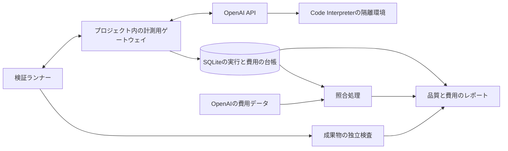

# LLM検証のゲートウェイと費用計測

更新日: 2026-10-12

[帳票編集の実験](../plans/llm-file-editing-evaluation.md)で使うゲートウェイと費用台帳の設計。ローカルのゲートウェイ、SQLite台帳、合成ケース、静的評価器は実装済みである。実験結果は[PoCレポート](../reports/llm-file-editing-poc-2026-10-12.md)、実行方法は[README](../../experiments/llm-export/README.md)にまとめている。

## 構成

実験用のOpenAI API呼び出しは、すべて計測用ゲートウェイを通す。ゲートウェイはAPIキー、使用量の記録、料金計算、予算管理を担当し、実験ランナーは各ケースの実行と採点を担当する。Excelを編集する環境には、APIキーや費用台帳を渡さない。

初回の実装は `experiments/llm-export` 内のNode/TypeScriptプロセスとSQLiteで構成した。HTTPはループバックアドレスだけで待ち受け、実行ごとのトークンで認証する。既存のHono/Cloudflare Workersアプリへの組み込みは、実験で必要な動作が固まってから検討する。生成コードやLibreOfficeはゲートウェイの外で実行する。

ファイルのアップロード、コンテナの操作、成果物の取得と削除も同じクライアントを通す。課金の有無にかかわらず、どの試行で作成・利用したファイルやコンテナかを追えるようにする。転送先は使用するOpenAIの操作とモデルに限定する。

## 費用の区分

| 区分                   | 根拠                                      | レポート上の扱い                                            |
| ---------------------- | ----------------------------------------- | ----------------------------------------------------------- |
| 使用量                 | 各API応答のusage                          | APIが返した計測値。欠落は不明として残す                     |
| 使用量から計算した費用 | usageと実行日の料金表                     | ケース・試行・モデル別の推計額                              |
| OpenAI側の計上額       | Costs APIまたはダッシュボードの費用データ | ホスト型ツールを含む実験専用Projectの期間集計として照合する |
| OpenAI以外の費用       | 外部の変換環境、ゲートウェイ、ログ保存等  | OpenAI計上額に含まれないものだけを別計上する                |

ゲートウェイで計算できるのは、APIの使用量に基づく推計額である。OpenAI側の計上額も別に取り込み、差額と未照合の項目を記録する。税やクレジットを含む最終的な支払額が必要な場合は、API利用料とは別欄に記載する。

Code Interpreterのコンテナ料金は、OpenAI利用料の内訳として計上する。提供元の集計に含まれている場合は再び足さない。外部サービスの費用も重複を除いて計上し、推計総額と照合済みの総額は分けて表示する。

OpenAI Costs APIで取得できるのは日単位の集計で、Project・課金項目・APIキーなどで絞り込める。任意の `run_id` ごとの請求額は取得できない。管理権限も必要なため、通常のモデル実行キーだけで利用できるわけではない。[Costs API](https://developers.openai.com/api/reference/resources/admin/subresources/organization/subresources/usage/methods/costs)

費用を照合しやすくするため、実験専用のOpenAI ProjectとAPIキーを使うことを推奨する。同じProjectで他の処理を動かさなければ、同じUTC期間の台帳と提供元集計を比較できる。管理キーは照合用プロセスだけで使う。管理権限がなければダッシュボードの費用データを取り込み、それまでは「請求未照合」と記録する。

## 台帳に記録する情報

同じケースの再実行、同じ試行中のモデルとの複数往復、通信の再送を区別する。

| 記録           | 主な項目                                                                                        |
| -------------- | ----------------------------------------------------------------------------------------------- |
| 実験           | `experiment_id`、ケース集合・方式・予算、料金表の版、開始・終了日時                             |
| 試行           | `run_id`、ケース・モデル・プロンプト・入力の版、反復番号、品質判定、全体時間                    |
| API呼び出し    | `call_id`、`run_id`、論理的な操作ID、再送番号、endpoint、要求・応答モデル、開始・終了日時、状態 |
| 使用量と計算額 | 生のusage、単価・通貨・料金表の版、内訳、推計額、予算予約額                                     |
| 実行環境       | `container_id`、対応する試行、メモリ、作成・利用・終了情報、課金単位と推計額                    |
| 照合           | 対象Project・UTC期間、取得日時、提供元計上額、台帳集計、差額、未解明理由                        |

API呼び出しには `response_id`、提供元の `x-request-id`、クライアントが発行する `X-Client-Request-Id`、HTTP状態、エラーを保存する。これらのIDは追跡に使うもので、同じIDを付けても二重課金を防げるとは限らない。[リクエストIDの説明](https://developers.openai.com/api/reference/overview)

usageは元のJSONを保存し、入力・キャッシュ読込・キャッシュ書込・出力・思考トークンを抽出する。キャッシュと思考トークンは内訳なので、合計に重複して足さない。料金区分も記録し、計算途中では丸めずに精度を保つ。単価が未登録のモデルや料金区分は実行前に止める。[usageの項目](https://developers.openai.com/api/reference/cli/resources/responses/methods/create)

usageが欠けた場合や、通信切断・タイムアウト・`incomplete` が発生した場合も、成果物の合否とは別に費用の状態を残す。最終回答がなくても、思考トークンなどの料金が発生している可能性がある。[推論時の使用量](https://developers.openai.com/api/docs/guides/reasoning)

## 漏れと二重計上を防ぐ実行方法

1. **送信前に予約を保存する。** 試行、呼び出し予定、費用の予約額をSQLiteのトランザクションで記録する。保存できなければ送信しない。
2. **初回は順に実行する。** 同時実行数を1にし、使用済み推計額、処理中・費用不明の呼び出しの予約額、次の呼び出しの予約額を合算して予算を確認する。実験全体と試行ごとの上限を調べる。
3. **再試行は明示的に記録する。** SDK・プロキシの自動リトライとモデルの自動切り替えは無効にする。ランナーから再送する場合は、別の呼び出しとして記録する。
4. **費用が分からなければ予約を残す。** タイムアウトなどで送信先の処理状況が分からない場合は、自動で再送せず、応答の取得や費用照合を試みる。再起動後も同じ扱いとする。
5. **同じ応答は一度だけ計上する。** usageを受信したら、予約額を推計額に置き換える処理を1トランザクションで確定する。保存できなければ予約を残し、新しい有料呼び出しを止める。再取得した応答を重複計上しない。台帳の障害に備え、認証情報を除いた生の応答も保存する。
6. **コンテナを試行と結び付ける。** 初回は試行ごとに専用コンテナを作り、同じ試行内でだけ再利用する。コンテナ料金はツール呼び出しの回数では数えない。実行時間や課金単位から確定できない分は、推計として残して後で照合する。
7. **キャッシュの条件を記録する。** ゲートウェイ側の応答キャッシュは無効にする。提供元のプロンプトキャッシュは別に扱い、usageで利用量を確認する。

ホスト型ツールでは、途中の処理やタイムアウト後の動作まで制御できないことがある。出力、応答回数、実行時間、コンテナ規模を制限し、予算に余裕がなくなる前に新しい送信を止める。ただし、この送信制御で実際の請求額の上限を保証することはできない。

## Cloudflare AI Gatewayの位置付け

既存アプリがCloudflare Workersを使っているため、将来ゲートウェイを共有環境へ移す際にはCloudflare AI Gatewayも候補になる。初回はローカルで実装し、共有ダッシュボードや複数人の実行管理が必要になった段階で追加を検討する。

CloudflareにはOpenAI Responses用の経路がある。ただし、表示する費用はトークン数と登録単価による推計なので、OpenAI側の計上額との照合は別途必要になる。Files・Containers・成果物取得にも使えるかは導入時に確認し、非対応の操作もプロジェクト側の台帳で記録する。[OpenAI接続](https://developers.cloudflare.com/ai-gateway/usage/providers/openai/)、[費用表示の制約](https://developers.cloudflare.com/ai-gateway/observability/costs/)

追加する場合は持ち込みOpenAIキーでOpenAIに課金する経路を使う。CloudflareのUnified Billingはクレジット購入に5%の手数料がある。基本機能とログ保存の料金条件も異なるため、追加費用はOpenAI利用料と別に記録する。[Cloudflare料金](https://developers.cloudflare.com/ai-gateway/reference/pricing/)

## 構築時の確認手順

1. ローカルのゲートウェイ、SQLite台帳、固定料金表、予算予約、JSON/CSV出力を作る。ローカルのランナーがgit管理外の `.env` からキーを読み、同一プロセスのゲートウェイへ渡す。提供元への認証に使うのはゲートウェイだけで、生成環境・評価器へは渡さない。
2. モック応答で料金計算、キャッシュ・思考の二重加算防止、不完全応答、タイムアウト、重複応答、再起動後の未完了予約、予算超過による送信拒否を検証する。
3. 専用Projectと通常APIキーを設定し、料金上限を確定する。実キーはチャットや成果物ではなく、git管理外の環境設定へ入れる。
4. 小さなAPI呼出し1件とコード実行1件で、usage・ID・コンテナの記録を確認する。この動作確認費用も検証の総費用へ含める。
5. OpenAIの費用データが反映された時点で同じ期間を照合する。取得遅延は0円と扱わず保留にする。照合額は推計額へ加算せず、比較する別の列として保持する。
6. 帳票の基本4ケースを実行し、品質と費用を一緒にまとめる。予算予約と記録が動作する前に大量実行しない。

結果レポートには、モデル・書式別の初回成功率、修復後の結果、実行時間、総トークン数、失敗分を含む推計費用、成功1件あたりの費用を載せる。請求データを取得できた場合は、対象期間、台帳との差額、未解決件数、外部費用も記載する。試行ごとに配分した推計額と、提供元の確定請求額は区別する。