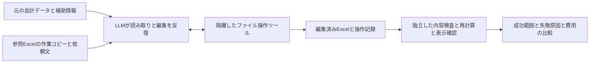

# LLMによる会計帳票の直接編集の検証計画

更新日: 2026-10-12

位置付け: 方針転換後の方式検証。品質・費用の実測に基づいて本実装の方式を選ぶ。

[ドキュメント一覧](../README.md) / [全体の進捗](accounting-export.md)

## 検証する方針

会計データ、大学のExcel書式、記入に必要な補助情報、自然言語の依頼をLLMへ渡し、LLM自身が書式を読み、分類・集計・配置・編集・保存まで行う。大学別Data Frameやセル対応表を先に実装する開発は、方式検証の結果が出るまで進めない。

最初は、隔離された実行環境でLLMがコードを書いてファイルを編集する方式を試す。成果物を独立に検査し、成功した範囲、失敗の原因、所要時間、成功1件あたりの費用を記録する。少数の成功例だけで、本番で自動提出できると判断しない。

API呼び出しは、このプロジェクトの[計測用ゲートウェイ](../design/llm-evaluation-gateway.md)に集約する。初回は設定済みのOpenAI APIキーで、指定された `gpt-6.1-sol`、`gpt-6-luna`、`gpt-5.6-luna` を比較し、使用量からの推計費用とOpenAI側の計上額を照合する。他モデル・他社の比較は今回の初回PoCに含めない。

既存の変換実装は比較・参照用に残す。金額の一致、明細の欠落防止、書式・数式の保持という[出力品質の要件](../requirements/accounting-export.md)は引き継ぐ。生成方法をLLMへ任せても、検証用の入力と正しさの基準は独立して用意する。

## 現状と検証範囲

アプリでは `packages/accounting-export` のSnapshotから費目別Data Frameへの変換と合成データのテストが実装済み。Excel/PDF生成、LLM連携、DBからの出力用取得、出力APIのアプリへの組み込みは未実装。独立した `experiments/llm-export` のゲートウェイ・実行器・静的評価器は準備済みであり、実測後にアプリへの組み込みを判断する。

| 対象   | 使用する参照コピー                                                             | 確認したい難しさ                                                         |
| ------ | ------------------------------------------------------------------------------ | ------------------------------------------------------------------------ |
| 立命館 | [ritsumeikan.reference.xlsx](../references/ritsumeikan.reference.xlsx)         | 1シート、費目別集計、現金と預金の内訳、コメント、署名欄                  |
| 学習院 | [gakushuin.reference.xlsx](../references/gakushuin.reference.xlsx)             | 書式と見本の2シート、階層的な費目、繰越を含む報告上の合計                |
| 法政   | [hosei.synthetic.reference.xlsx](../references/hosei.synthetic.reference.xlsx) | 2シート、費目ごとの明細枠、領収書番号、非表示列、図形、共有数式          |
| 早稲田 | [waseda-2025.reference.xlsx](../references/waseda-2025.reference.xlsx)         | 5シート、参照リスト、VLOOKUP、拡張入力規則、活動・補助金・領収書との関係 |

これらは提供された版の参照コピーで、最新版の正式な提出用テンプレートではない。初回の早稲田は会計報告シートを対象とし、他シートの保持を確認する。これを提出書類一式の完成とは数えない。横浜国立・明治は資料未入手のため評価対象外とする。製品の初期対象大学とは区別する。

法政には元から6セルの参照切れ数式がある。通常の記入課題では修正させず、元の不備と新たに生じた不備を分ける。既存エラーを維持しただけの出力は「記入課題の成功」として評価できても、「提出品質を満たす」とは扱わない。詳しい来歴は[参照資料の管理](../references/README.md)を参照する。

## 編集方式と比較条件

| 方式             | LLMへ渡す操作                                                    | 用途                                                    |
| ---------------- | ---------------------------------------------------------------- | ------------------------------------------------------- |
| A コード実行     | ファイルの読み取り、Pythonなどの実行、結果の再読込、成果物の保存 | 初回の主方式。LLMが自分で書式を調べて編集する能力を測る |
| B 共通の帳票操作 | シート・セル・図形等の検査、範囲書込、行やシートの複製、保存     | Aの失敗が操作の不安定さに起因する場合に比較する         |

どちらにも大学別の分類関数・セル配置表・完成済みData Frameは渡さない。Bのツールが大学ごとの判断を内部で代行すると、別の仮説の検証になる。Bは最初から全面実装せず、Aで判明した問題に対応する最小限の比較条件として追加する。

初回AはOpenAI Responses APIとCode Interpreterを候補とする。公式にはXLSXの入力と生成ファイルの取得に対応するが、今回の書式保持は実測が必要である。[OpenAI Code Interpreter](https://developers.openai.com/api/docs/guides/tools-code-interpreter)

他社モデルとの能力比較へ進む場合は、同じ実行環境、ファイル、ツール仕様、依頼文、制限を使う。ホストされたコード実行環境が異なる比較は「モデルと実行環境の組み合わせの比較」と明記する。生成コードを実行する環境には作業コピーだけを置き、リポジトリ・DB・認証情報へのアクセスは持たせない。

依頼文は2条件を区別する。主条件は元データ・書式・共通の依頼だけ。補助条件では大学の記入要領も渡す。補助条件の改善量と、要領の準備にかかった手作業も記録する。採点用の正解表や後述の未見ケースをモデルに見せない。

## 入力と依頼文

入力は合成の取引JSONとする。各取引には識別子、収支区分、金額、日付、項目、内訳、用途などの事実を持たせ、帳票のセル位置は含めない。団体・対象期間・開始残高・現金預金内訳・領収書提出情報などは補助情報として明示する。

現在のDBには購入日・用途・大学固有情報等が十分に保存されていない。そのため「情報が揃ったときの編集能力」と「実アプリの情報だけで完了できる範囲」を別々に評価する。欠けた事実をLLMに推測させて成功扱いにはしない。

共通依頼の骨子は次のとおり。大学ごとのセル番地は追加しない。

> 添付の取引と補助情報を使って、このExcelの指定された会計報告を記入してください。まず全シートと記入上の説明を調べてください。提出対象の入力欄に残る記入例を今回のデータと混ぜず、見本専用シートは維持してください。元の書式・計算式・入力規則を保持し、必要な集計を行い、編集したファイルを保存して再度確認してください。不足情報や矛盾があれば、事実を補わず具体的に報告してください。修正した箇所と未完了事項も返してください。

## 実験の順序と停止条件

| 段階                 | 実施内容                                                                                     | 次へ進む条件                                                                   |
| -------------------- | -------------------------------------------------------------------------------------------- | ------------------------------------------------------------------------------ |
| 0 事前確認           | 4参照コピーのハッシュ・ZIP・XML・シート・元の数式不備を記録。APIと再計算環境の利用条件を確認 | 使用ファイルと既存不備が確定                                                   |
| 0a 費用計測の準備    | ゲートウェイ・台帳・予算制御をモックで検証し、少額のAPI呼出しで動作確認                      | 失敗・再送・コンテナ費用まで追跡でき、提供元費用との照合経路がある             |
| 1 編集エンジンの確認 | 同じライブラリで無変更の読込・保存と1セルの変更を行い、図形・入力規則・書式等を比較          | 消失する機能と影響が判明。必要ならZIP内の限定変更等へ切替                      |
| 2 最小の成立確認     | A方式、GPT-6.1 Sol、4書式の基本記入を各1回。立命館、学習院、法政、早稲田の順                 | 保存だけでなく値・集計・保持を検査できる                                       |
| 3 モデル比較         | 同じ基本4ケースをGPT-6 Luna、GPT-5.6 Lunaでも実行。3モデル×4書式で初回12試行                 | 元資料・不足情報・モデル・ツール・再計算・制限超過のどこで失敗したか説明できる |
| 4 反復と費用比較     | 固定した方式で各組合せを合計3回、計36試行。原因切り分けの追加試行は別枠で記録                | 再試行を含めた成功率と費用を算出できる                                         |
| 5 採用判断           | 適用できる帳票、必要な人の確認、費用、実装量、残る条件をまとめる                             | 本実装へ進む条件または保留理由が明示される                                     |

段階1で無変更保存だけでも書式が壊れる場合、そのエンジンの結果からモデルの能力不足を結論付けない。段階2・3で基本記入が成立しなければ、大規模反復を始めず原因を調べる。予算・時間・反復上限に達した実行は失敗または未完了として残す。

初回PoCの想定費用は約3〜6米ドル、推奨する総予算枠は10米ドルとする。以下の試算条件に基づく計画値であり、実測値や承認済み予算ではない。最初に各モデルの少額の接続確認と編集エンジンの確認を行い、基本12試行の結果と実使用量を見てから合計36試行へ進む。基本12試行は36試行の内数であり、別途加算しない。

初期実装は1試行につきモデル応答1回、出力上限8,000トークン（指定可能な最大12,000）、API待機10分。自動リトライは行わない。各リクエスト前に、計上済みの推計費用、処理中・料金不明の呼出しの予約額、次の呼出しの保守的な予約額を合算し、予算内に収まらない呼出しを止める。入力100,000トークン分を予約するが、組込ツールの結果による入力増大を事前に厳密には制限できない。組込ツールは1応答内で複数回動くため、制御できない回数を厳密に制御済みと報告しない。タイムアウト後もサーバー側で処理が続いた場合の料金は後から照合する。この制御で実請求額の絶対上限を保証するものとはしない。

## 検証ケースと採点

| ケース         | 主な確認点                                                                           |
| -------------- | ------------------------------------------------------------------------------------ |
| 基本記入       | 少数の収入・支出を正しい費目へ反映。元データと金額・日付・用途が一致                 |
| 0件            | 入力欄のサンプル取引が残らず、既知の繰越を正しく扱う                                 |
| 枠の境界       | 1費目の収容件数ちょうど、その1件超で欠落・重複しない                                 |
| 長文と文字種   | 日本語長文・改行・先頭ゼロの番号が保たれ、`=...`で始まる入力文が数式にならない       |
| 不足と矛盾     | 開始残高・用途・領収書区分・現金預金内訳が不明な場合、必要情報を報告する             |
| 大学固有の意味 | 学習院の繰越と費目階層、立命館の残高内訳、早稲田の既提出領収書と年間支出を混同しない |
| 再編集と再計算 | 支出を50円増やしたコピーで、関連合計と残高が正しく変わる                             |
| 件数と未見条件 | 100件・1,000件、別の取引値、行位置等を変えた派生書式への対応                         |

基本ケースでプロンプトと実行方式を調整した後に固定し、未見ケースへ進む。初期比較は同じケースをモデルごとに3回、候補が絞れたら重要ケースを5回実行する。予算が足りない場合は件数を減らして実際の分母を示す。小標本から本番の信頼性やp95を断定しない。

正しさは次の独立した証拠で判定する。

1. 入力から別途計算した件数、費目別金額、総額、残高を成果物から読み取って照合する。全取引がちょうど1回寄与することを確認し、集計帳票では集計元の対応記録も検査する。対応記録は照合の補助であり、モデルの自己申告だけで合格にしない。
2. 事前にレビューした帳票別の採点用セル・ラベル対応で記入内容を読む。この対応は評価器だけが持つ。モデルの書込先をそのまま正解にしない。完成ブック全体のバイナリ一致は求めない。
3. ZIP/XML、内部参照、式、結合、書式、行列サイズ、非表示、名前定義、図形、コメント、入力規則、印刷設定を比較する。要求された変更以外の欠落を検出する。
4. Excelまたは採用する再計算エンジンで開き、数式を再計算する。式文字列や保存済みキャッシュだけで動作確認済みとしない。LibreOfficeの成功とExcelでの互換性確認は区別する。
5. PDFまたは印刷表示を全ページ確認し、日本語・金額の切れ、見落としたページ、意図しない空ページを記録する。

枠を超えた際の行追加・継続シートは、技術的に作成できても大学が受理する形式とは限らない。正式ルールがないケースは「技術検証のみ」と表示する。

実行結果は「成功」「一部成功」「入力不足を正しく検出」「失敗」「評価不能」を分ける。通常の記入課題の成功率と、不足検出課題の正答率を別々に出す。数式や表示を未確認の成果物を完全成功に含めない。金額不一致、取引の欠落・重複、不足情報の捏造、新たな数式破損、必要な書式の消失がある成果物は不合格とする。

## 実測前に提示した費用試算

2026-10-12確認。USD、100万トークンあたりのStandard・短コンテキスト料金。3モデルとも公式にResponses APIのCode Interpreterへ対応し、設定済みキーで取得したモデル一覧にも存在する。以下は実行前の見積もりであり、実測は[検証結果](../reports/llm-file-editing-poc-2026-10-12.md)へ分けて記録する。

| モデルID       | 通常入力 | キャッシュ読込 | キャッシュ書込 |   出力 |
| -------------- | -------: | -------------: | -------------: | -----: |
| `gpt-6.1-sol`  |    $2.00 |          $0.10 |          $2.50 | $10.00 |
| `gpt-6-luna`   |    $0.10 |          $0.01 |         $0.125 |  $0.50 |
| `gpt-5.6-luna` |    $0.20 |          $0.02 |          $0.25 |  $1.20 |

出典: [GPT-6.1 Sol](https://developers.openai.com/api/docs/models/gpt-6.1-sol)、[GPT-6 Luna](https://developers.openai.com/api/docs/models/gpt-6-luna)、[GPT-5.6 Luna](https://developers.openai.com/api/docs/models/gpt-5.6-luna)。

1試行は1書式・1モデル・1応答とし、内部のツール処理・思考を含む請求対象の合計使用量を、入力10,000／出力3,000〜入力50,000／出力8,000トークンと仮定する。これは実測から得た分布や信頼区間ではない。ファイルのバイト数をそのままトークン数と見なさず、最初の実測で仮定を更新する。

キャッシュの割引は期待せず、試算では全入力を通常の1.25倍のキャッシュ書込単価で計算する。これは余裕を持たせるための仮定で、全入力が実際に書込料金になるという意味ではない。出力には思考トークンを含め、二重加算しない。Standard以外の優先処理・地域加算・長コンテキストは使わない前提とする。

各編集試行に専用の1GB Code Interpreterコンテナ1つ、20分以内で$0.03を加える。適格セッションには最低5分の分単位課金もあるが、試算では割引を当てにしない。[コンテナ料金](https://developers.openai.com/api/docs/pricing)

`1試行の試算 = 入力トークン × キャッシュ書込単価 ÷ 1,000,000 + 出力トークン × 出力単価 ÷ 1,000,000 + $0.03`

| モデル       |          1編集試行 | 4書式×3回の12試行 |
| ------------ | -----------------: | ----------------: |
| GPT-6.1 Sol  |   $0.0850〜$0.2350 |  $1.0200〜$2.8200 |
| GPT-6 Luna   | $0.03275〜$0.04025 |  $0.3930〜$0.4830 |
| GPT-5.6 Luna |   $0.0361〜$0.0521 |  $0.4332〜$0.6252 |
| 3モデル合計  |                  — |  $1.8462〜$3.9282 |

初回12試行（4書式×3モデル×1回）だけなら$0.6154〜$1.3094。その12試行を含め、同じ基本ケースを3回ずつ比較した36試行が上表の合計となる。

| 初回PoCに含める作業                  |                                                     数 |         想定費用 |
| ------------------------------------ | -----------------------------------------------------: | ---------------: |
| 固定条件での基本比較                 |                                             36編集試行 | $1.8462〜$3.9282 |
| 無変更保存・編集ライブラリの保持確認 | Solで4応答。各応答で1書式の無変更保存と1セル変更を確認 | $0.3400〜$0.9400 |
| 原因調査・修復の追加枠               |                                 各モデル2試行、計6試行 | $0.3077〜$0.6547 |
| テキストだけの接続確認               |          各モデル1回、入力1,000以下・出力256以下を仮定 |      約$0.01以内 |
| 合計（丸め）                         |                                             最大49応答 |   約$2.50〜$5.54 |

予算説明では合計を**約$3〜$6、推奨枠$10**とする。追加の6試行は主比較の成功率とは分けて記録し、使わなければ費用も発生しない。対照実験の実行器はその後に追加し、実施状況と費用を実測へ計上する。

入力100,000、出力12,000、全入力がキャッシュ書込料金というさらに大きい仮定では、36比較試行$6.2148、4対照試行$1.6000、6追加試行$1.0358、接続確認約$0.01で計約$8.86。これも予算予約のシナリオであり、実請求額の保証ではない。ツール出力の増大、再実行、追加コンテナ・長時間実行は別途費用を生み得る。

この金額にはAPI・ホスト型コード実行を含む。ゲートウェイはローカル実行とし、追加のホスティング費用を計上しない。税・為替・人による確認作業・外部PDF変換サービス・本番運用費は含めない。未見・境界・大量データ・正式な提出品質の追加検証は、この初回PoCの結果から範囲を決めて再見積もりする。

実測費用は、全リクエストの未キャッシュ入力・キャッシュ入力・キャッシュ書込・請求対象出力を、重複せず各単価に掛け、ツール・コンテナ・変換費用を加算する。思考トークンが出力内訳の場合は二重加算しない。成功1件あたりの費用は、失敗・修復・再試行を含む総費用を検査合格した成果物数で割る。成功0件なら算出不能とする。

初回成功率、許可した修復後の成功率、総所要時間、ツール回数、修復回数、人の確認・修正時間も併記する。モデル料金と人件費は分け、円換算する場合は換算日・為替レートを明記する。

## 記録と採用判断

各実行にはモデルID・応答に返る版情報・日時・推論設定・プロンプトの版とハッシュ・入力とテンプレートのハッシュ・実行環境とライブラリ版・ツール定義・制限を残す。作業ディレクトリを実行ごとに分け、履歴・キャッシュによる別ケースの混入を避ける。

保存するものは、合成入力、指示、実際のツール呼出しと結果、生成コード、成果物、差分と採点、usage、所要時間、費用明細。正解情報は評価側に置き、モデル実行環境へ渡さない。学習用のプロンプト修正と未見ケースの採点を混ぜない。

| 判断                                 | 条件と次の作業                                                                                                         |
| ------------------------------------ | ---------------------------------------------------------------------------------------------------------------------- |
| 限定した本実装へ進む                 | 対象書式の未見・反復ケースで重大な誤りがなく、式と表示まで検査できる。成功費用・待ち時間・人の確認量が運用目標に収まる |
| 人が確認する下書き作成へ限定         | 有用な記入はできるが、誤り・不足・書式崩れが残る。対象範囲と必須確認項目を明示する                                     |
| 共通ツールや記入要領を追加して再検証 | 必要情報はあるが、操作や説明の不足が主因。追加実装と維持コストも評価する                                               |
| 保留                                 | 元資料や入力が不足、保持可能な編集手段がない、費用や成功率が運用に合わない                                             |

少数試行で重大な誤りが出なかったことは無人運用の保証ではない。自動提供の成功率・料金・許容待ち時間の本番目標は、初回の実測から決める。旧計画の暫定p95 5秒を、この方式の採用基準としてそのまま使わない。

## 現在の実施状況

- 4ファイル・10シートのZIP/XML事前検査でエラーなし、元ファイルのハッシュ不変。法政の既存の参照切れ数式6セルを確認。
- ローカルの[計測用ゲートウェイと実行手順](../../experiments/llm-export/README.md)、SQLite台帳、合成の基本4ケース、静的評価器、対照実験、JSON/CSV/Markdownレポートと共有用スナップショットを実装済み。
- ユーザーが推奨予算$10で実験の実行を指示。指定の3モデルで接続確認を行い、同じゲートウェイ・台帳で接続確認3応答、保存対照4応答、基本ケース36応答、追加条件4応答を完了した。自動再試行は行っていない。推計費用$2.924513275、未解決費用・残予約0。
- Microsoft Excel 16.113.4で、使い捨てコピーによる再計算・表示確認を別途実施。ローカルではLibreOfficeを検出していないが、モデル側Code Interpreter環境ではLibreOffice 25.2.3.2の利用が確認された。両者を同じ証拠として扱わない。
- 合否、評価器の訂正、ネイティブ確認の範囲、追加条件の試行、費用、残課題は[検証結果](../reports/llm-file-editing-poc-2026-10-12.md)に集約する。提供元の請求額との照合は未完了であり、usageからの積み上げを確定請求額と呼ばない。

静的な事前検査はリポジトリのルートから `python3 experiments/llm-export/preflight.py` で実行できる。標準出力にJSONを返し、元のExcelは変更しない。保存済みの[事前検査結果](../../experiments/llm-export/preflight.json)は実行時点の記録として残す。
