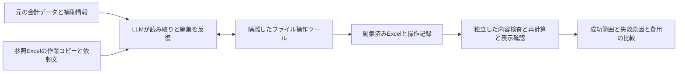

# LLMによる会計帳票の直接編集の検証計画

更新日: 2026-10-12

既存Excelの編集をLLMに任せられるか、品質と費用から確かめるための計画。以下に初回PoCの実施前に決めた条件を残す。実験は完了しており、実測結果と次の検証は[結果レポート](../reports/llm-file-editing-poc-2026-10-12.md)に記録している。

[ドキュメント一覧](../README.md) / [全体の進捗](accounting-export.md)

## 検証する方針

会計データ、大学のExcel書式、記入に必要な補助情報と依頼文をLLMに渡す。LLMが書式を調べ、分類・集計・配置を判断してファイルを編集する。大学別Data Frameやセル対応表の本実装は、この方式の検証後に判断する。

まず、隔離環境でLLMがコードを書いてファイルを編集する方法を試す。生成ファイルはモデルとは別の評価器で検査し、成功した範囲、失敗の原因、所要時間、成功1件あたりの費用を調べる。自動提出を検討するには、この基本実験とは別に提出品質の検証が必要になる。

実験用のAPI呼び出しは[計測用ゲートウェイ](../design/llm-evaluation-gateway.md)を通す。初回は `gpt-6.1-sol`、`gpt-6-luna`、`gpt-5.6-luna` の3モデルを比較し、使用量から費用を推計する。OpenAI側の計上額との照合も計画する。他のモデルや他社のサービスは初回の比較対象に含めない。

既存の変換実装は比較用に残す。生成方法をLLMに任せても、金額の一致、明細の欠落防止、書式・数式の保持という[品質要件](../requirements/accounting-export.md)は変わらない。評価用の入力と正解は、モデルが生成するコードとは別に用意する。

## 現状と検証範囲

従来方式では `packages/accounting-export` のSnapshotから費目別Data Frameへの変換と、合成データによるテストが実装されていた。アプリ側のExcel/PDF生成、LLM連携、DBからの出力用データ取得、出力APIは未実装である。

今回の実験コードは `experiments/llm-export` に分け、アプリとは独立したゲートウェイ、ランナー、静的評価器を用意した。

| 対象   | 使用する参照コピー                                                             | 確認したい難しさ                                                         |
| ------ | ------------------------------------------------------------------------------ | ------------------------------------------------------------------------ |
| 立命館 | [ritsumeikan.reference.xlsx](../references/ritsumeikan.reference.xlsx)         | 1シート、費目別集計、現金と預金の内訳、コメント、署名欄                  |
| 学習院 | [gakushuin.reference.xlsx](../references/gakushuin.reference.xlsx)             | 書式と見本の2シート、階層的な費目、繰越を含む報告上の合計                |
| 法政   | [hosei.synthetic.reference.xlsx](../references/hosei.synthetic.reference.xlsx) | 2シート、費目ごとの明細枠、領収書番号、非表示列、図形、共有数式          |
| 早稲田 | [waseda-2025.reference.xlsx](../references/waseda-2025.reference.xlsx)         | 5シート、参照リスト、VLOOKUP、拡張入力規則、活動・補助金・領収書との関係 |

対象は提供資料をもとにした参照コピーで、最新版の正式な提出用テンプレートではない。早稲田では会計報告シートの記入と、ほかのシートの保持を確認する。提出書類一式の作成は対象外である。横浜国立・明治は資料が未入手のため、製品の初期対象大学とは異なる4大学で評価する。

法政の元ファイルには、参照切れの数式が6セルある。通常の記入課題では修正対象から外し、元からある不備と編集で生じた不備を分けて調べる。この課題に成功しても、既存エラーが残る以上、そのまま提出できる品質とは判断できない。来歴は[参照資料の管理](../references/README.md)に記録している。

## 編集方式と比較条件

| 方式             | LLMへ渡す操作                                                    | 用途                                                    |
| ---------------- | ---------------------------------------------------------------- | ------------------------------------------------------- |
| A コード実行     | ファイルの読み取り、Pythonなどの実行、結果の再読込、成果物の保存 | 初回の主方式。LLMが自分で書式を調べて編集する能力を測る |
| B 共通の帳票操作 | シート・セル・図形等の検査、範囲書込、行やシートの複製、保存     | Aの失敗が操作の不安定さに起因する場合に比較する         |

どちらの方式でも、大学別の分類関数、セル配置表、完成済みData Frameは渡さない。Bでは帳票の判断を代行せず、Aで間違えやすかったファイル操作だけを共通ツールで支える。必要な範囲から追加し、Aと比べる。

初回のA方式にはOpenAI Responses APIとCode Interpreterを使う。XLSXの入力と生成ファイルの取得に対応しているが、対象書式を保てるかは実際のファイルで確認する。[Code Interpreterの説明](https://developers.openai.com/api/docs/guides/tools-code-interpreter)

他社モデルへ比較を広げる場合は、実行環境、入力ファイル、ツール仕様、依頼文、制限をそろえる。コード実行環境も異なる場合は、モデル単体ではなく環境との組み合わせを比較したと明記する。生成コードには作業コピーだけを渡し、リポジトリ、DB、認証情報へのアクセスは与えない。

依頼文は、元データ・書式・共通の指示だけを渡す主条件と、大学の記入要領も渡す補助条件に分ける。補助条件では結果の改善だけでなく、要領を準備する手間も記録する。採点用の正解や、後で評価する新しいケースはモデルに見せない。

## 入力と依頼文

入力は合成の取引JSONとする。各取引には識別子、収支区分、金額、日付、項目、内訳、用途などの事実を持たせ、帳票のセル位置は含めない。団体・対象期間・開始残高・現金預金内訳・領収書提出情報などは補助情報として明示する。

現在のDBには購入日、用途、大学固有の情報などが十分に保存されていない。そのため、必要な情報をそろえた場合の編集能力と、実アプリのデータだけでできる範囲は分けて調べる。不足情報を推測で補った出力は成功に数えない。

共通依頼の骨子は次のとおり。大学ごとのセル番地は追加しない。

> 添付の取引と補助情報を使って、このExcelの指定された会計報告を記入してください。まず全シートと記入上の説明を調べてください。提出対象の入力欄に残る記入例を今回のデータと混ぜず、見本専用シートは維持してください。元の書式・計算式・入力規則を保持し、必要な集計を行い、編集したファイルを保存して再度確認してください。不足情報や矛盾があれば、事実を補わず具体的に報告してください。修正した箇所と未完了事項も返してください。

## 実験の順序と停止条件

| 段階                 | 実施内容                                                                                     | 次へ進む条件                                                                   |
| -------------------- | -------------------------------------------------------------------------------------------- | ------------------------------------------------------------------------------ |
| 0 事前確認           | 4参照コピーのハッシュ・ZIP・XML・シート・元の数式不備を記録。APIと再計算環境の利用条件を確認 | 使用ファイルと既存不備が確定                                                   |
| 0a 費用計測の準備    | ゲートウェイ・台帳・予算制御をモックで検証し、少額のAPI呼出しで動作確認                      | 失敗・再送・コンテナ費用まで追跡でき、提供元費用との照合経路がある             |
| 1 編集エンジンの確認 | 同じライブラリで無変更の読込・保存と1セルの変更を行い、図形・入力規則・書式等を比較          | 消失する機能と影響が判明。必要ならZIP内の限定変更等へ切替                      |
| 2 最小の成立確認     | A方式、GPT-6.1 Sol、4書式の基本記入を各1回。立命館、学習院、法政、早稲田の順                 | 保存だけでなく値・集計・保持を検査できる                                       |
| 3 モデル比較         | 同じ基本4ケースをGPT-6 Luna、GPT-5.6 Lunaでも実行。3モデル×4書式で初回12試行                 | 元資料・不足情報・モデル・ツール・再計算・制限超過のどこで失敗したか説明できる |
| 4 反復と費用比較     | 固定した方式で各組合せを合計3回、計36試行。原因切り分けの追加試行は別枠で記録                | 再試行を含めた成功率と費用を算出できる                                         |
| 5 採用判断           | 適用できる帳票、必要な人の確認、費用、実装量、残る条件をまとめる                             | 本実装へ進む条件または保留理由が明示される                                     |

段階1で無変更の保存だけでも書式が壊れる場合は、保存ライブラリの影響を先に調べる。段階2・3で基本的な記入ができなければ、反復回数を増やす前に原因を確認する。予算・時間・反復上限に達した試行も、失敗または未完了として記録に残す。

計画時点では初回PoCを約3〜6米ドルと見積もり、予算枠として10米ドルを提案した。各モデルの接続確認と保存ライブラリの対照実験から始め、基本12試行の結果と使用量を見て残る試行に進む。この12試行を含めた合計が36試行である。

初期実装では1試行につきモデル応答1回、出力上限8,000トークン（指定できる最大値は12,000）、API待機時間10分とする。自動リトライは行わない。

送信前に、使用済みの推計額、処理中・費用不明の呼び出しの予約額、次の呼び出しの予約額を合算し、予算を超える送信を止める。入力100,000トークン分を予約するが、内部ツールの結果で入力が増えることや、タイムアウト後に処理が続く可能性がある。応答内のツール実行回数も厳密には制御できないため、ローカルの予算制御だけで請求額の上限を保証することはできない。

## 検証ケースと採点

| ケース         | 主な確認点                                                                           |
| -------------- | ------------------------------------------------------------------------------------ |
| 基本記入       | 少数の収入・支出を正しい費目へ反映。元データと金額・日付・用途が一致                 |
| 0件            | 入力欄のサンプル取引が残らず、既知の繰越を正しく扱う                                 |
| 枠の境界       | 1費目の収容件数ちょうど、その1件超で欠落・重複しない                                 |
| 長文と文字種   | 日本語長文・改行・先頭ゼロの番号が保たれ、`=...`で始まる入力文が数式にならない       |
| 不足と矛盾     | 開始残高・用途・領収書区分・現金預金内訳が不明な場合、必要情報を報告する             |
| 大学固有の意味 | 学習院の繰越と費目階層、立命館の残高内訳、早稲田の既提出領収書と年間支出を混同しない |
| 再編集と再計算 | 支出を50円増やしたコピーで、関連合計と残高が正しく変わる                             |
| 件数と未見条件 | 100件・1,000件、別の取引値、行位置等を変えた派生書式への対応                         |

基本ケースでプロンプトと実行方式を調整し、条件を固定してから新しい入力で評価する。最初のモデル比較は同じケースを3回ずつ実行し、候補を絞った後は重要なケースを5回試す。予算が足りなければ回数を減らし、実際に試した件数を示す。本番の信頼性やp95の評価には、さらに多くのデータが必要になる。

モデルの説明だけに頼らず、次の方法で結果を確かめる。

1. **金額と件数を照合する。** 入力から別途計算した件数、費目別金額、総額、残高を、成果物から読んだ値と比べる。各取引が1回ずつ反映されているかを確かめ、集計帳票では元取引との対応記録も調べる。モデルの説明は照合の補助に使う。
2. **記入場所を確認する。** 事前にレビューした帳票別のセル・ラベル対応を評価器に持たせる。モデルが選んだ書き込み先を、そのまま正解には使わない。完成ファイル全体のバイナリ一致は求めない。
3. **元の構造と機能を比べる。** ZIP/XML、内部参照、数式、結合、書式、行列サイズ、非表示設定、名前定義、図形、コメント、入力規則、印刷設定を調べ、依頼した範囲以外に欠落がないか確認する。
4. **数式を再計算する。** Excelまたは採用する計算エンジンで開き、数式が動くか確認する。数式文字列や保存キャッシュの検査とは分けて記録する。LibreOfficeでの成功も、Excelでの互換性確認とは別に扱う。
5. **全ページの表示を確認する。** PDFまたは印刷表示で、日本語や金額の欠け、出力されていないページ、意図しない空ページを調べる。

枠を超えた際の行追加・継続シートは、技術的に作成できても大学が受理する形式とは限らない。正式ルールがないケースは「技術検証のみ」と表示する。

実行結果は「成功」「一部成功」「入力不足を正しく検出」「失敗」「評価不能」に分ける。通常の記入課題と、不足を検出する課題は別に集計する。数式や表示が未確認のものは、完全な成功には数えない。金額の誤り、明細の欠落・重複、不足情報の捏造、新たな数式の破損、必要な書式の消失があれば不合格とする。

## 実測前に提示した費用試算

2026-10-12確認。USD、100万トークンあたりのStandard・短コンテキスト料金。3モデルとも公式にResponses APIのCode Interpreterへ対応し、設定済みキーで取得したモデル一覧にも存在する。以下は実行前の見積もりであり、実測は[検証結果](../reports/llm-file-editing-poc-2026-10-12.md)へ分けて記録する。

| モデルID       | 通常入力 | キャッシュ読込 | キャッシュ書込 |   出力 |
| -------------- | -------: | -------------: | -------------: | -----: |
| `gpt-6.1-sol`  |    $2.00 |          $0.10 |          $2.50 | $10.00 |
| `gpt-6-luna`   |    $0.10 |          $0.01 |         $0.125 |  $0.50 |
| `gpt-5.6-luna` |    $0.20 |          $0.02 |          $0.25 |  $1.20 |

出典: [GPT-6.1 Sol](https://developers.openai.com/api/docs/models/gpt-6.1-sol)、[GPT-6 Luna](https://developers.openai.com/api/docs/models/gpt-6-luna)、[GPT-5.6 Luna](https://developers.openai.com/api/docs/models/gpt-5.6-luna)。

1試行は1書式・1モデル・1応答とする。内部のツール処理と思考を含めた課金対象の使用量を、入力10,000／出力3,000〜入力50,000／出力8,000トークンと仮定して試算した。ファイルのバイト数をトークン数に置き換えたものではなく、最初の実験で見直すための仮定である。

キャッシュの割引は期待せず、試算では全入力を通常の1.25倍のキャッシュ書込単価で計算する。これは余裕を持たせるための仮定で、全入力が実際に書込料金になるという意味ではない。出力には思考トークンを含め、二重加算しない。Standard以外の優先処理・地域加算・長コンテキストは使わない前提とする。

各編集試行に専用の1GB Code Interpreterコンテナ1つ、20分以内で$0.03を加える。適格セッションには最低5分の分単位課金もあるが、試算では割引を当てにしない。[コンテナ料金](https://developers.openai.com/api/docs/pricing)

`1試行の試算 = 入力トークン × キャッシュ書込単価 ÷ 1,000,000 + 出力トークン × 出力単価 ÷ 1,000,000 + $0.03`

| モデル       |          1編集試行 | 4書式×3回の12試行 |
| ------------ | -----------------: | ----------------: |
| GPT-6.1 Sol  |   $0.0850〜$0.2350 |  $1.0200〜$2.8200 |
| GPT-6 Luna   | $0.03275〜$0.04025 |  $0.3930〜$0.4830 |
| GPT-5.6 Luna |   $0.0361〜$0.0521 |  $0.4332〜$0.6252 |
| 3モデル合計  |                  — |  $1.8462〜$3.9282 |

初回12試行（4書式×3モデル×1回）だけなら$0.6154〜$1.3094。その12試行を含め、同じ基本ケースを3回ずつ比較した36試行が上表の合計となる。

| 初回PoCに含める作業                  |                                                     数 |         想定費用 |
| ------------------------------------ | -----------------------------------------------------: | ---------------: |
| 固定条件での基本比較                 |                                             36編集試行 | $1.8462〜$3.9282 |
| 無変更保存・編集ライブラリの保持確認 | Solで4応答。各応答で1書式の無変更保存と1セル変更を確認 | $0.3400〜$0.9400 |
| 原因調査・修復の追加枠               |                                 各モデル2試行、計6試行 | $0.3077〜$0.6547 |
| テキストだけの接続確認               |          各モデル1回、入力1,000以下・出力256以下を仮定 |      約$0.01以内 |
| 合計（丸め）                         |                                             最大49応答 |   約$2.50〜$5.54 |

以上から、計画時点では**約$3〜$6、予算枠$10**を提案した。追加の6試行は主比較と分け、使った分だけ計上する。対照実験のランナーは後から追加し、実施回数と費用は結果レポートに記録した。

入力100,000、出力12,000、全入力がキャッシュ書込料金というさらに大きい仮定では、36比較試行$6.2148、4対照試行$1.6000、6追加試行$1.0358、接続確認約$0.01で計約$8.86。これも予算予約のシナリオであり、実請求額の保証ではない。ツール出力の増大、再実行、追加コンテナ・長時間実行は別途費用を生み得る。

この金額にはAPI・ホスト型コード実行を含む。ゲートウェイはローカル実行とし、追加のホスティング費用を計上しない。税・為替・人による確認作業・外部PDF変換サービス・本番運用費は含めない。未見・境界・大量データ・正式な提出品質の追加検証は、この初回PoCの結果から範囲を決めて再見積もりする。

実測費用は、全リクエストの未キャッシュ入力・キャッシュ入力・キャッシュ書込・請求対象出力を、重複せず各単価に掛け、ツール・コンテナ・変換費用を加算する。思考トークンが出力内訳の場合は二重加算しない。成功1件あたりの費用は、失敗・修復・再試行を含む総費用を検査合格した成果物数で割る。成功0件なら算出不能とする。

初回成功率、許可した修復後の成功率、総所要時間、ツール回数、修復回数、人の確認・修正時間も併記する。モデル料金と人件費は分け、円換算する場合は換算日・為替レートを明記する。

## 記録と採用判断

各試行では、モデルIDと応答の版情報、日時、推論設定、指示・入力・テンプレートの版とハッシュ、実行環境とライブラリの版、ツール定義、制限を記録する。作業ディレクトリも分け、ほかのケースの履歴やキャッシュが混ざらないようにする。

合成入力、指示、実際のツール呼び出しと結果、生成コード、成果物、差分、採点結果、usage、所要時間、費用明細を保存する。正解は評価側だけで使う。プロンプトの調整に使ったケースと、条件を固定した後で評価するケースは分ける。

| 判断                                 | 条件と次の作業                                                                                                         |
| ------------------------------------ | ---------------------------------------------------------------------------------------------------------------------- |
| 限定した本実装へ進む                 | 対象書式の未見・反復ケースで重大な誤りがなく、式と表示まで検査できる。成功費用・待ち時間・人の確認量が運用目標に収まる |
| 人が確認する下書き作成へ限定         | 有用な記入はできるが、誤り・不足・書式崩れが残る。対象範囲と必須確認項目を明示する                                     |
| 共通ツールや記入要領を追加して再検証 | 必要情報はあるが、操作や説明の不足が主因。追加実装と維持コストも評価する                                               |
| 保留                                 | 元資料や入力が不足、保持可能な編集手段がない、費用や成功率が運用に合わない                                             |

少数の試行で重大な誤りが出なくても、無人運用の信頼性は判断できない。本番で必要な成功率、費用、待ち時間は初回の実測を踏まえて決める。旧計画の暫定p95 5秒を、今回の方式へそのまま当てはめることはしない。

## 現在の実施状況

- 4ファイル・10シートのZIP/XML事前検査はエラーなし。元ファイルのハッシュも不変だった。法政には既存の参照切れ数式が6セルある。
- [実験ランナー](../../experiments/llm-export/README.md)、ゲートウェイ、SQLite台帳、合成の基本4ケース、静的評価器、対照実験、各種レポートの出力処理を実装した。
- 予算$10で、接続確認3応答、保存対照4応答、基本比較36応答、追加実験4応答を実行した。自動リトライはなく、推計費用は$2.924513275。費用が未確定の呼び出しと、未精算の予約は0件だった。
- 一部のファイルはMicrosoft Excel 16.113.4でも再計算や表示を確認した。モデルの実行環境ではLibreOffice 25.2.3.2も使われていたが、ローカルでは検出していない。
- 合否、評価器の修正、確認した範囲、追加実験、費用、残る課題は[結果レポート](../reports/llm-file-editing-poc-2026-10-12.md)にまとめた。OpenAIの請求額との照合は未完了である。

静的な事前検査はリポジトリのルートから `python3 experiments/llm-export/preflight.py` で実行できる。標準出力にJSONを返し、元のExcelは変更しない。保存する場合は、Git管理外の `experiments/llm-export/artifacts/preflight.json` に出力する。
