# LLMによる会計帳票編集の説明スライド

[スライドを開く](index.html) / [PDF](llm-file-editing-slides.pdf) / [配布用ZIPの作成](#配布用zip) / [詳細な検証結果](../llm-file-editing-poc-2026-10-12.md)

以前の会計データ管理のSVG資料の配色・字体を引き継いだ、日本語14枚のスライド。仕組み、実際のツール反復、比較結果、費用、限界を説明する。SVGは1600 × 900。PNGは3200 × 1800ピクセルで、スライドソフトや文書へ貼り付けられる。

index.htmlは図を埋め込んだ単独ファイルで、外部サービスへの通信なしで表示できる。左右キー・Space・ページ選択で移動し、一覧表示と補足・出典も利用できる。ブラウザーの印刷では全ページを出力する。参照資料へのリンクは元のリポジトリ内の位置を前提とする。

「interactive」はAIとコード実行環境の反復を指す。利用者向けの会話編集画面は今回未実装。実験費用$2.924513275はusageによる推計であり、確定請求額ではない。

## 1. AIに帳票の解釈と編集を任せる

[SVG](01-overview.svg) / [PNG](01-overview.png)

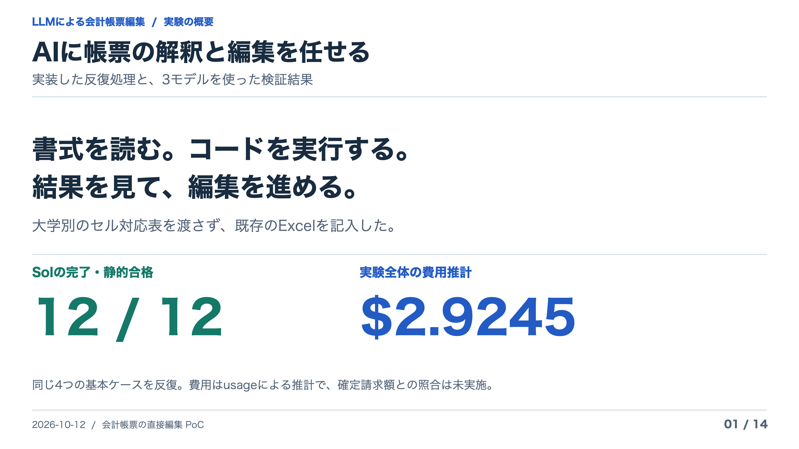

## 2. 方針転換で変えたこと

[SVG](02-approach.svg) / [PNG](02-approach.png)

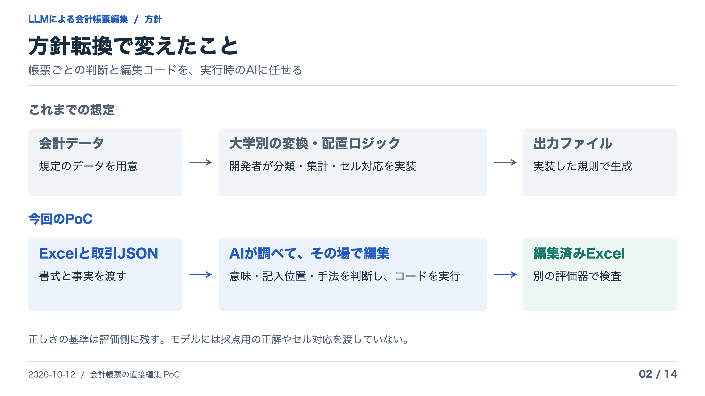

## 3. 実装の全体構成

[SVG](03-architecture.svg) / [PNG](03-architecture.png)

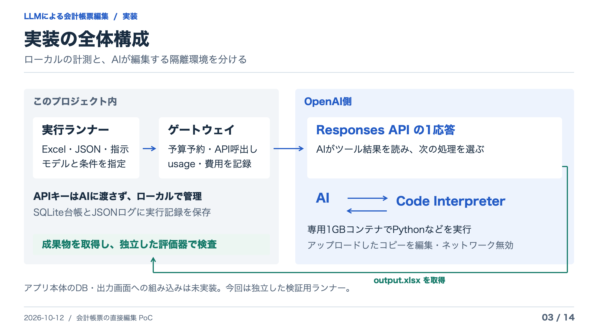

## 4. AIとツールのやり取り

[SVG](04-tool-loop.svg) / [PNG](04-tool-loop.png)

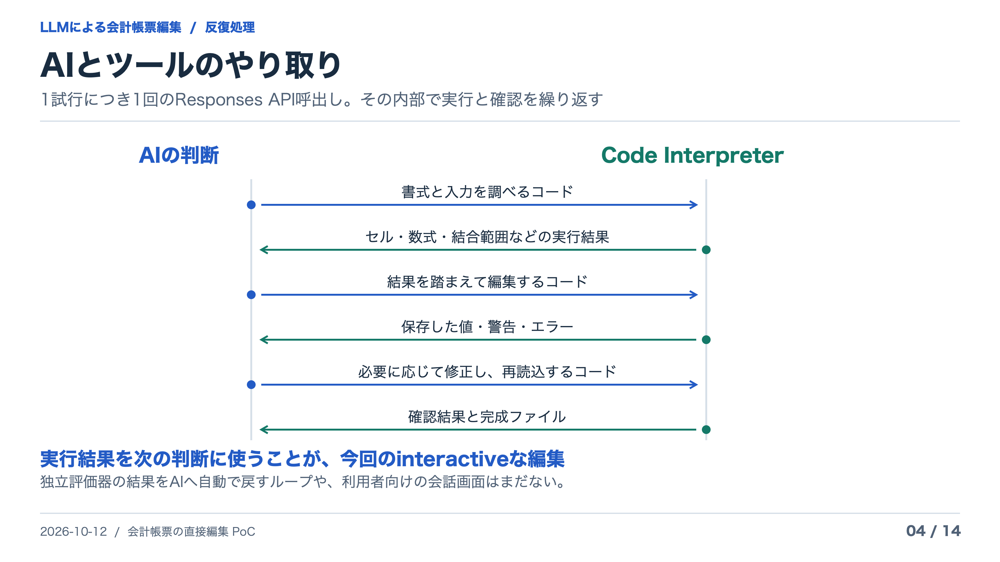

## 5. 実際の反復例：Sol × 学習院

[SVG](05-real-trace.svg) / [PNG](05-real-trace.png)

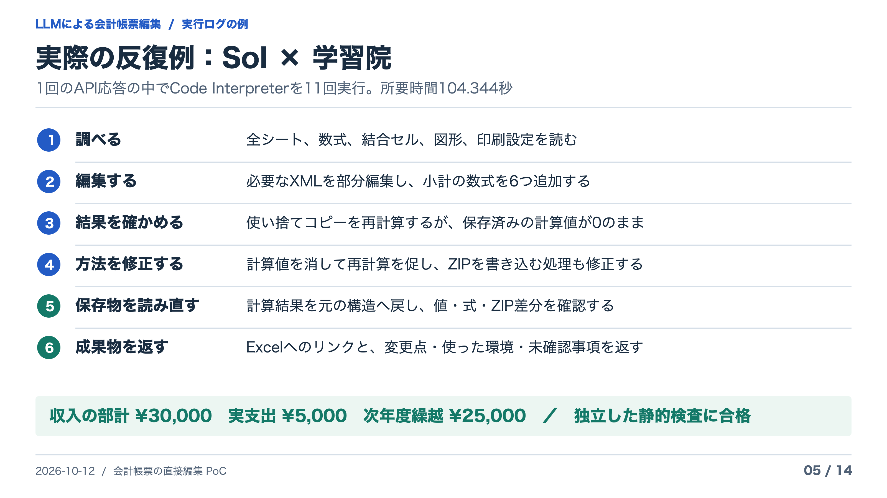

## 6. API費用をゲートウェイで計測

[SVG](06-cost-gateway.svg) / [PNG](06-cost-gateway.png)

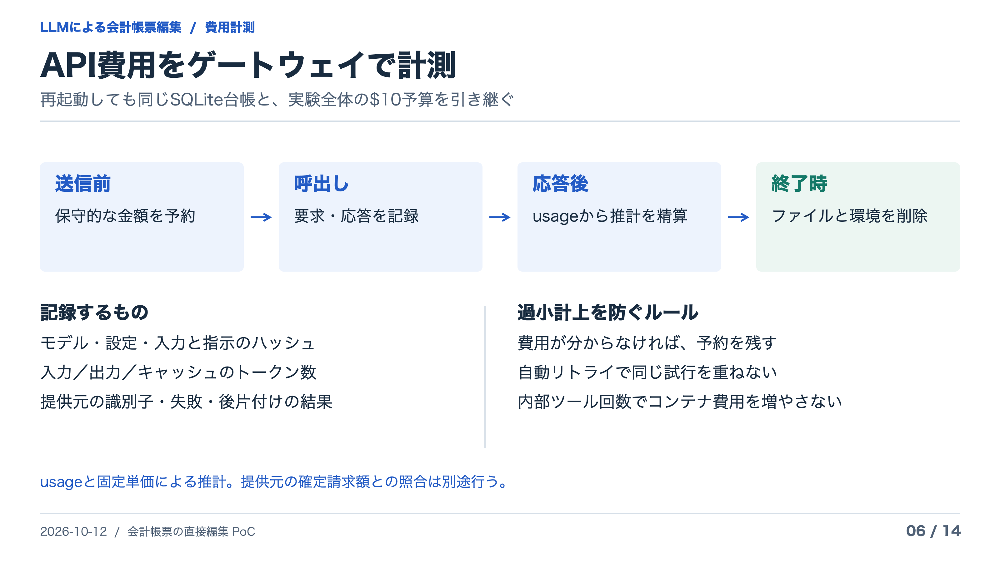

## 7. 比較した条件

[SVG](07-experiment.svg) / [PNG](07-experiment.png)

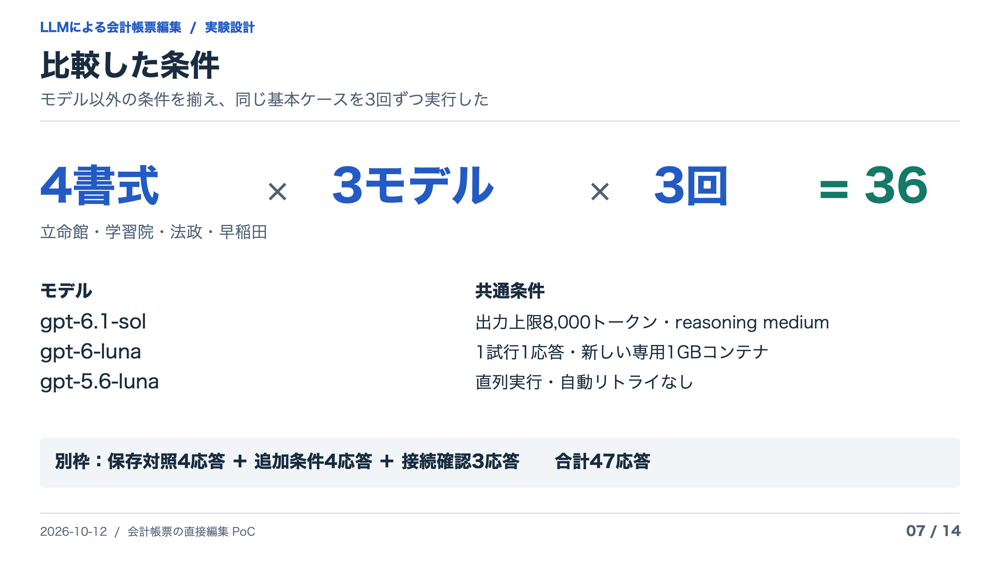

## 8. 合格と完了を分けて確認

[SVG](08-evaluation.svg) / [PNG](08-evaluation.png)

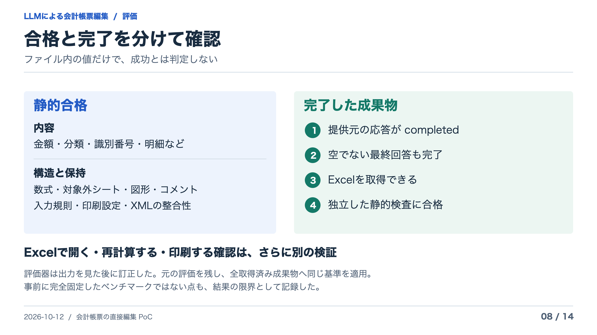

## 9. Solが12回すべてで合格・完了

[SVG](09-results.svg) / [PNG](09-results.png)

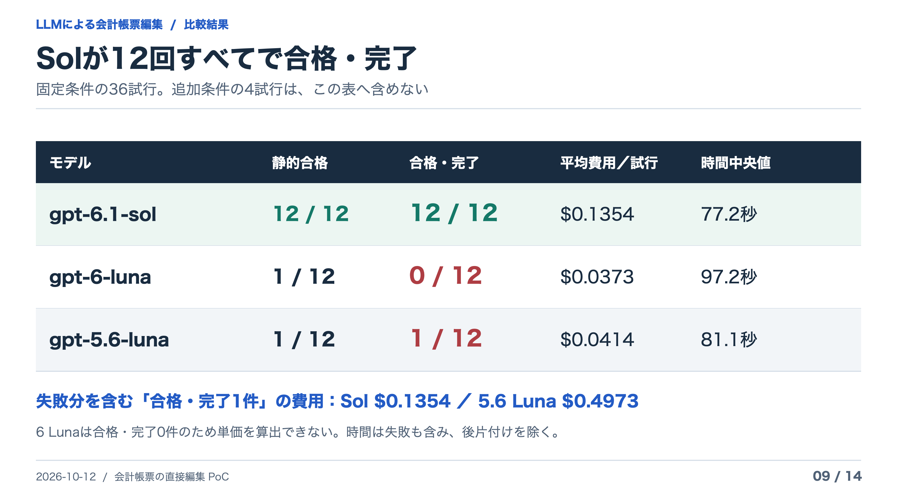

## 10. 金額が合っていても、帳票は壊れる

[SVG](10-failures.svg) / [PNG](10-failures.png)

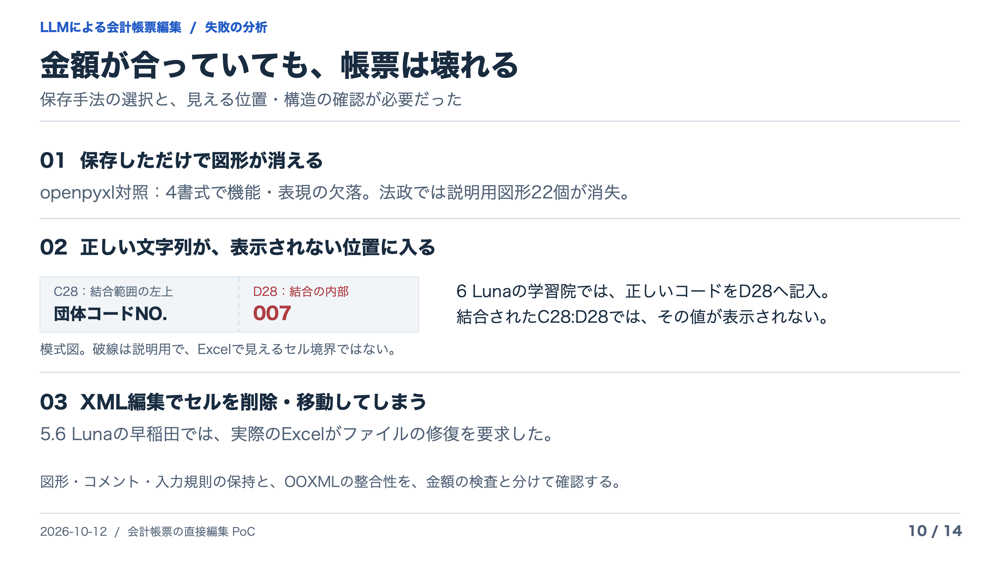

## 11. 追加条件でも、課題が残った

[SVG](11-followups.svg) / [PNG](11-followups.png)

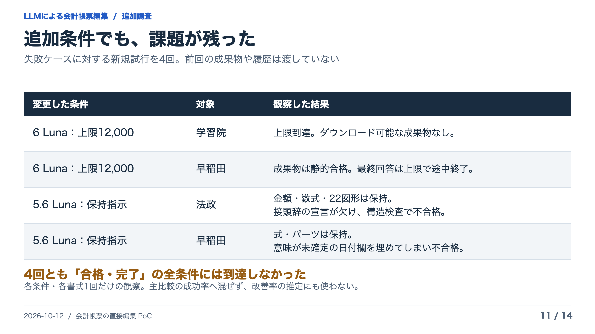

## 12. 実験全体の費用は、推計$2.9245

[SVG](12-cost-results.svg) / [PNG](12-cost-results.png)

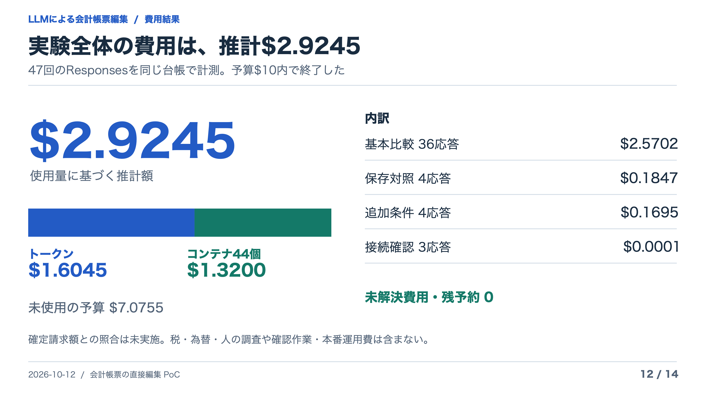

## 13. 生成したExcelを、実際のExcelでも確認

[SVG](13-artifact-proof.svg) / [PNG](13-artifact-proof.png)

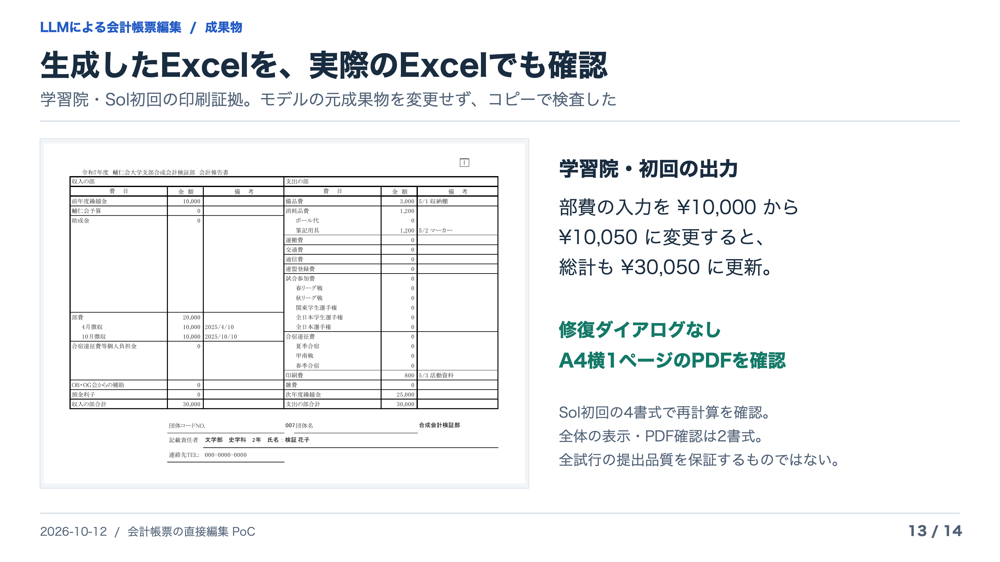

## 14. 次の候補は、Solによる下書き生成

[SVG](14-next-steps.svg) / [PNG](14-next-steps.png)

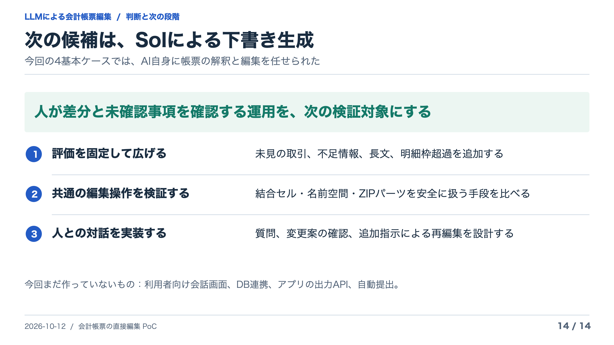

## 配布用ZIP

`python3 docs/reports/llm-file-editing-slides/package.py` でSVG・PNG・PDF・HTML一式の llm-file-editing-slides.zip を生成する。ZIPは配布用の重複データなのでgit管理外。元の資料はこのフォルダーに保存している。

## 編集と再生成

`node docs/reports/llm-file-editing-slides/build.mjs` でSVG、HTML、目次、スライド補足を再生成する。実測値は保存済みsummary.jsonを読み取り、APIは呼ばない。

PNGとPDFはmacOSのAppKitでオフライン生成した。同梱の render-png.swift に入力SVG・出力PNG・倍率2を渡すとPNGを、render-pdf.swift に出力PDF・14枚の入力SVGを順に渡すとPDFを再生成できる。フォントはHiragino Sansを使用。生成後は文字のはみ出し・画像・全ページの表示を確認する。

成果物の図版は実際のExcel印刷PDFから作った画像。SVG内へ埋め込んであり、外部フォント・画像・JavaScriptライブラリは取得しない。
