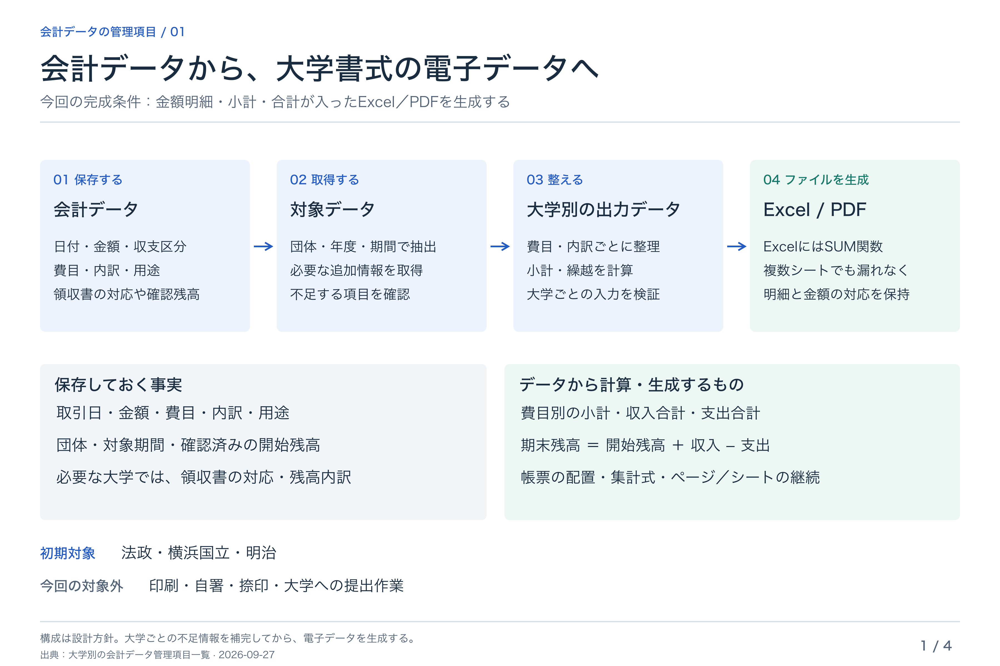
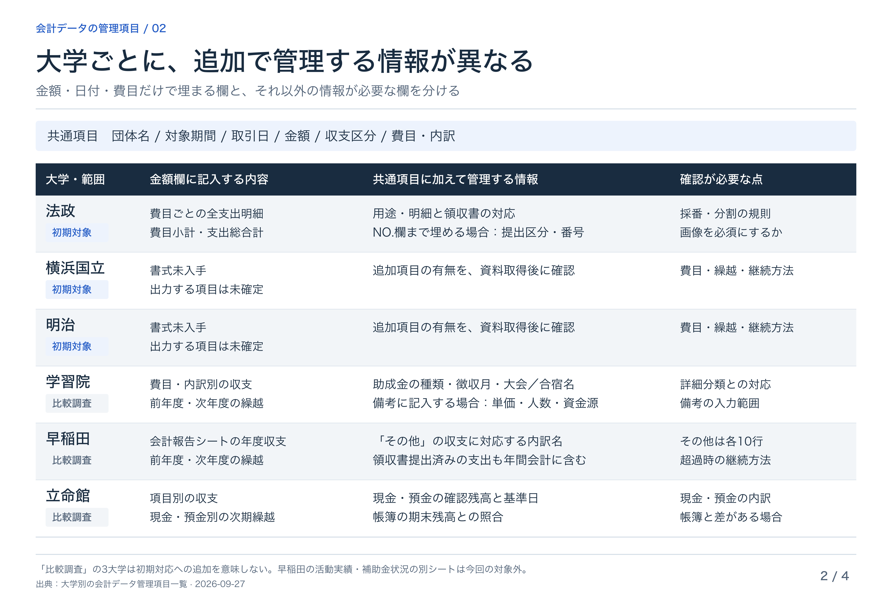
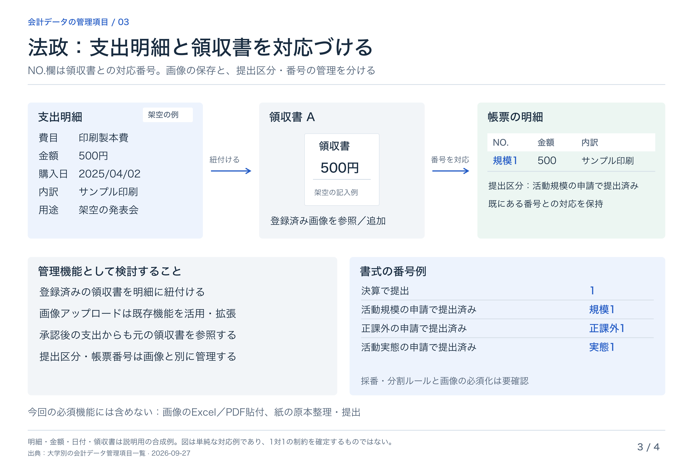
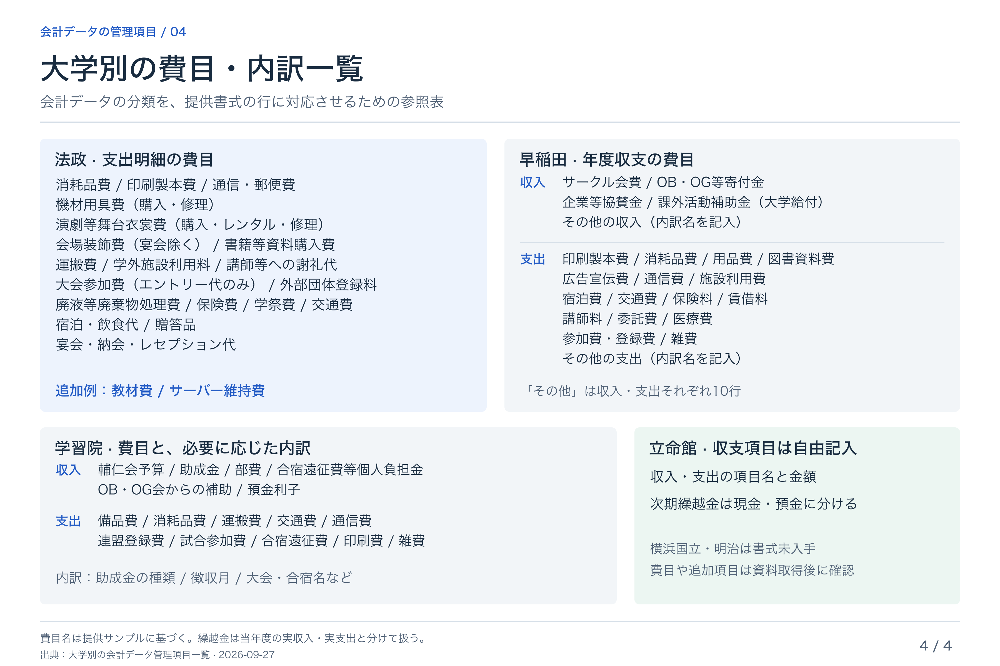

# 会計データ管理の説明用図表

[大学別の会計データ管理項目一覧](../accounting-data-checklist.md)を基にした共有用資料。金額明細・小計・合計が記入されたExcel／PDFの生成を対象に、大学別の違いと必要な情報を整理している。

- 共有用画像：PNG、各3600 × 2400ピクセル
- 編集用データ：SVG
- [PNG 4枚をまとめてダウンロード](accounting-data-visuals-png.zip)
- 初期対応：法政・横浜国立・明治。学習院・早稲田・立命館は比較調査として掲載
- 法政の取引・領収書・金額・日付は説明用の合成例
- 領収書画像の全件必須化、採番・分割の運用は未確定
- 提供サンプルに基づく設計整理であり、最新の正式書式・必須条件を確定するものではない

## 1. 会計データから大学書式への出力

保存する事実、大学別に整えるデータ、自動計算・ファイル生成の範囲。

[PNG](01-export-flow.png) / [編集用SVG](01-export-flow.svg)

## 2. 大学別の比較

金額欄の内容、追加で管理する情報、確認が必要な点。

[PNG](02-university-comparison.png) / [編集用SVG](02-university-comparison.svg)

## 3. 法政の領収書管理

支出明細と領収書の紐付け、既存画像アップロード機能の活用、提出区分と帳票番号の関係。

[PNG](03-hosei-receipts.png) / [編集用SVG](03-hosei-receipts.svg)

## 4. 費目・内訳の参照表

提供書式にある主な収支項目と、追加・自由記入項目の扱い。詳細な助成金の種類等は元の一覧を参照。

[PNG](04-category-reference.png) / [編集用SVG](04-category-reference.svg)

